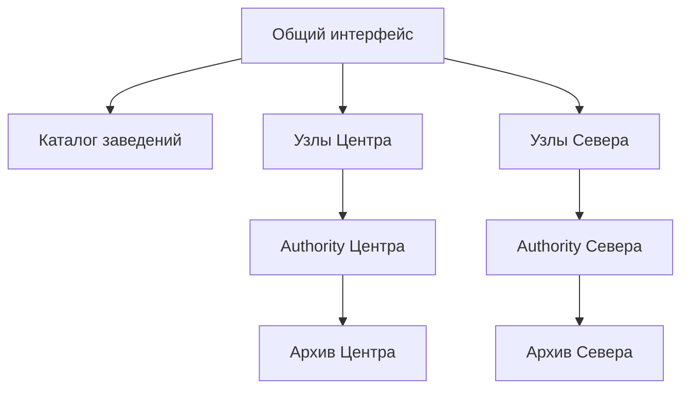

# Сеть пиццерий

После `npm ci` и `npm run build` запустите `npm run start:network`. Общий интерфейс — http://localhost:3500. Не запускайте одновременно одиночный `npm start` на том же порту.

Первый запуск создаёт два заведения: «Центр» (порт 3511) и «Север» (3521), по одному узлу чтения на заведение. Демо-аккаунты из README существуют отдельно в каждом. Выберите заведение, войдите нужной ролью и выполните обычный заказ или складскую операцию. Сессии сохраняются раздельно в `sessionStorage`; регистрация и назначение ролей относятся только к выбранному заведению.

## Что масштабируется

Заведения имеют независимые authority-процессы, ключи подписи и файловые архивы. Добавление заведения распределяет обработку записи по новому процессу. Его остановка не блокирует запись другого заведения. Внутри одного заведения запись сериализуется одним authority; дополнительных конкурирующих владельцев того же архива нет.

Узлы чтения запускаются настоящими процессами через `createStoreNode`. Они предоставляют ролевые фасады из реплики и передают команды authority с токеном конечного пользователя. Добавление узлов масштабирует подключения и выдачу живых данных, а не запись одного заведения.

Владелец видит «Обслуживание заведения»: задайте от 0 до 8 узлов и нажмите «Применить». Изменение завершено, когда процессы запущены/остановлены и новое число показано. Желаемое количество сохраняется между перезапусками сети. Менеджер, повар, курьер и клиент не имеют доступа к управлению процессами. Сервер повторно проверяет права владельца выбранного заведения при каждом запросе.

Клиент использует `followNodeDirectory`, `pickDirectoryNode`, `createRpcClientHub` и `syncStoreReplayRoute`. При потере выбранного узла он подключается к другому, а при отсутствии доступных узлов — к authority. Последние данные сохраняются в том же Store; новый источник передаёт свежий снимок, поскольку проекции разных процессов имеют независимые курсоры. Команды автоматически не повторяются; успешные повторные запросы с тем же requestId обслуживаются receipts библиотеки.

## Данные и размещение

`network-data/network.json` содержит список заведений, порты, желаемое число узлов и отдельные ключи. Каталоги `network-data/<id>/` содержат архивы состояния и receipts. Всё это исключено из git. `PIZZERIA_NETWORK_DATA` меняет корневой каталог; `SERVICE_PORT` — порт общего интерфейса.

Для добавления заведения остановите сеть и добавьте запись в `network.json` с уникальным латинским `id`, названием, свободным `port`, числом `nodes` и двумя независимо сгенерированными случайными ключами `tokenSecret`/`nodeToken`. Не копируйте ключи другого заведения. Установка выполняется из npm; библиотечные исходники не подменяются.

Файл `network.lock` запрещает запуск второго управляющего процесса над тем же каталогом. При штатной остановке он удаляется. После аварийной остановки сначала убедитесь, что указанный в нём процесс и его дочерние процессы завершены; только затем удалите оставшийся lock. Дочерние процессы завершаются при потере IPC-соединения с родителем.

Для резервной копии остановите сеть и сохраните весь каталог вместе с `network.json`. Ключи необходимы для сохранения действительности токенов после перезапуска. Не переименовывайте ID существующего заведения без переноса соответствующего архива.

Загруженные фото блюд хранятся в `network-data/<id>/photos/` и входят в резервную копию. Реплики содержат только идентификаторы, файлы выдаёт authority соответствующего заведения. Подробности и готовые изображения — в [DISHES.md](DISHES.md).

## Проверенные границы

`npm run test:network` запускает независимые процессы и проверяет токены и данные разных заведений, переход того же клиента между узлами, реальное увеличение/уменьшение числа процессов, работу второго заведения при аварии первого, восстановление архива и receipt, сохранение конфигурации после перезапуска всей сети.

В пяти отдельных вкладках пройден заказ клиент → повар → курьер, создание блюда и работа со складом менеджером, обнаружение порчи и восстановление после нехватки сырья, переключение заведений с раздельными сессиями. Владелец проверил обзор выручки, увеличение числа узлов и смену прав сотрудника в уже открытой вкладке. Подробности — в [отчёте](../../doc/reports/pizzeria-library-assessment.md).

Это локальный хост процессов. Управляющий HTTP-сервер слушает loopback; межмашинный оркестратор, автоматическое восстановление authority, перенос владельца записи, распределённая блокировка и балансировка уже подключённых клиентов при добавлении узла здесь не заявлены. После аварии authority доступно локальное `network.control.restart(id)` либо перезапуск всей сети. Удалённый restart намеренно не публикуется: проверка прав через недоступный authority не может подтвердить владельца.

«Обзор сети» подписывается на выручку через библиотечный клиент каждого заведения, где в этой вкладке сохранён вход владельца. Сводка показывает охват: недоступное заведение или отсутствие прав не подменяется нулевой выручкой. Для добавления доступа выберите другое заведение и войдите владельцем; при необходимости используйте «Обновить доступ к заведениям».

Каждая строка обзора владеет сессией через общий `useServiceSession` и библиотечный `useOwnedClient`; `useClientStore` следит за соединением, правами и выручкой. Права приходят из `identity.permissions` без периодического опроса. При отзыве роли или потере связи строка перестаёт участвовать в сумме; при возврате доступа восстанавливается реактивно. На реплике отзыв действует после доставки изменения ролей; синхронный отзыв на всех процессах не заявлен. Authority повторно проверяет каждую команду. Обновлённый токен сохраняется для следующего переключения заведений.

Состояние масштабирования привязано к заведению и токену. При переключении незавершённый запрос отменяется на клиенте, и его ответ не меняет новую панель. Уже принятое сервером изменение может завершиться: повторный вход показывает фактическое состояние процессов. Обновление обзора закрывает прежние сессии и создаёт новые. [Проверки версии 0.10.0](../../doc/changes/0.10.0.md).
