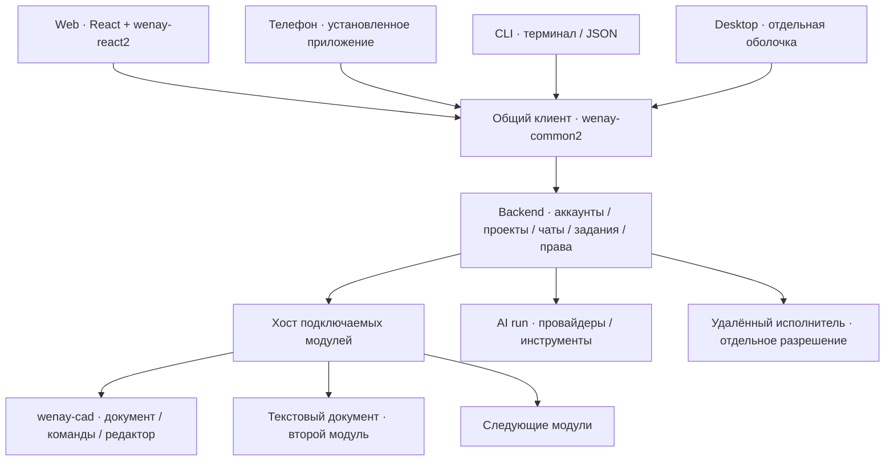

# Общий каркас приложений: backend, web, mobile, CLI и модули

27 сентября 2026. Рабочее имя нового продукта — **wenay-shell**.
Это план по уточнённому поручению пользователя, а не отчёт о реализации.
Обязательная основа: публичные API **wenay-common2** и **wenay-react2**.
Первый сложный подключаемый модуль — **wenay-cad** из соседнего проекта Dynamic.

Уточнение 27 сентября: ядро поддерживает разные разделы и подразделы, включая
самостоятельное видео-приложение без обязательного чата. Чат — главный экран
одного профиля продукта; профиль может выбрать другой главный раздел.
[Подробный план из 82 заданий](SHELL-EXECUTION-PLAN.md),
[контракты](SHELL-CONTRACTS.md) и [постановки агентам](SHELL-AGENT-BRIEFS.md)
уточняют порядок реализации и имеют приоритет при расхождении с общим планом ниже.

План уточняет [AI-CHAT-PRODUCT-PLAN](AI-CHAT-PRODUCT-PLAN.md) и сохраняет связь с его C01–C08.
ID S00–S10 ниже обозначают задачи каркаса; они не меняют готовность прежних этапов.
Общие правила реализации — [CODE-RULES](CODE-RULES.md).
В этой задаче подготовлен только план; приложения, соседний CAD и зависимости не изменялись.

## 1. Что получит пользователь

Один продукт с общими аккаунтами, проектами, чатами, заданиями и документами.
Пользователь начинает работу в браузере, продолжает на телефоне или из терминала
и видит то же сохранённое состояние. Подключённый модуль добавляет собственные
документы, команды, инструменты ИИ и экраны: CAD, редактор текста, видео, сайты.

Обязательные поставки: backend, web, установленное приложение телефона и CLI.
Под CLI здесь понимается приложение терминала: сначала обычные команды и JSON-вывод,
затем при необходимости интерактивный TUI. Desktop — отдельная поставка из предыдущего
поручения, со своими установкой, треем и обновлением; CLI его не заменяет.
Android и iOS входят в целевой план, их фактическая приёмка ведётся раздельно.

Пример законченного сценария: открыть проект с CAD, обсудить изменение в чате,
выполнить команду над выбранным документом, увидеть обновлённый чертёж и сохранить его.
На телефоне доступны тот же разговор, результат и документ; CLI читает состояние,
выполняет разрешённые команды и скачивает артефакт. После перезапуска сохраняется
документ, а не только сообщение «готово».

## 2. Проверенное основание и пробелы

Read-only аудит 27 сентября: примеры — исходный HEAD `2c121f8`, integration `db0ecac`;
CAD — HEAD `2f521c6` с незакоммиченными изменениями другой работы.
Тесты и приложения во время планирования не запускались. Указанные версии —
проверенный локальный срез, не утверждение о latest npm на дату реализации.

| Область | Что есть в исходниках | Что требуется новому продукту |
| --- | --- | --- |
| Chat в integration | common2 3.1.1 / react2 5.0.0; plain web, service identity, conversation, журнал, переключение контекста | Продуктовые аккаунты, динамические проекты, общий клиент, CLI, мобильный пакет, модули |
| Ответ помощника Chat | Детерминированное завершённое сообщение | Настоящий AI run, поток, инструменты, отмена и провайдер |
| Desktop Chat | Исходный Electron shell и proposal | Установка, обновление, tray/quit и сценарий нескольких клиентов |
| CAD | Локальный `wenay-cad` 0.14.0, private package; MCP stdio/HTTP, workspace, команды, WCAD, Canvas2D/Three | Публичная граница встраивания, scoped подключение к shell, приёмка общего документа |
| Библиотеки CAD | common2 2.21.2 / react2 3.5.1 | Проверка миграции и совместимости до встраивания в один UI bundle |
| CAD HTTP | Loopback host, optional token, один workspace на host | Пользовательские разрешения shell и изоляция документов; MCP session не является tenant |

В common2 уже есть conversation, структурированные блоки сообщений, resources,
receipts, replay и AI run. Не создавать рядом новый чат-протокол или журнал этих же фактов.
Существующие адаптеры владения ресурсами и persistence использовать после проверки их границ.
Демонстрационные пользователи, фиксированные workspace и `demo.reply` не становятся продуктовой моделью.

Известные ограничения conversation/AI lifecycle и receipt ACL должны быть проверены
на выбранных опубликованных версиях. Полный HTTP REST в текущем Chat намеренно
отключён, кроме login: CLI должен пользоваться тем же разрешённым native service client.
Источники открытых ограничений находятся в integration `doc/library-tasks/WORKAROUNDS.md`.
Состояние старого [реестра этого checkout](library-tasks/WORKAROUNDS.md) уже, чем integration.

## 3. Архитектура



Начальная серверная поставка — один сервис с явными фасадами и одним владельцем записи
на документ/проект. CAD может быть отдельным процессом из-за своей текущей границы.
Это не требует заранее строить микросервисную платформу или нескольких писателей.
Секреты провайдеров и машинные ключи модулей принадлежат backend.

Предлагаемая структура самостоятельного репозитория, создаваемая постепенно:

```text
apps/server       # запуск backend и сборка зависимостей
apps/web          # браузерная точка входа
apps/mobile       # пакет телефона и платформенные адаптеры
apps/cli          # терминальная точка входа
apps/desktop      # настольный пакет
packages/server   # предметная композиция сервисов shell
packages/client   # общий клиент без React, DOM и CAD renderer
packages/ui       # React-оболочка и места подключения экранов
packages/modules  # минимальная общая граница модулей
modules/text      # простой настоящий модуль документов
modules/cad       # адаптер wenay-cad и его визуальное подключение
```

Это адреса ответственности, а не требование заранее создать пустые пакеты.
Общий клиент выделяется при появлении web и CLI; контракт модулей проверяется на text и CAD.
Наши библиотеки подключаются точными опубликованными версиями. Соседние исходники
не подменяют npm-пакеты; отсутствующая публичная возможность оформляется библиотечной задачей.

## 4. Внутренняя модель

| Сущность | Ответственность |
| --- | --- |
| Подключение и аккаунт | Адрес backend и серверная identity; один пользователь может хранить несколько подключений |
| Рабочее пространство | Участники, роли и общие настройки; выбор пространства не выдаёт права сам по себе |
| Проект | Постоянный контейнер документов, файлов, чатов, модулей и разрешённых исполнителей |
| Чат | Разговор, его участники, сообщения и ссылки на документы/задания; обычный чат может жить без проекта |
| Документ модуля | Тип, владелец, версия формата, revision и исходные данные; структура определяется модулем |
| Задание | Выполнение с состоянием, прогрессом, отменой, результатом и сохранённым идентификатором |
| Артефакт | Файл, изображение, экспорт или ссылка на конкретную версию результата |
| Подключение модуля | Разрешённые возможности и настройки модуля в конкретном проекте |

Документ существует независимо от одного чата. Несколько разговоров могут ссылаться
на него; удаление разговора не должно неявно удалять исходный CAD-документ.
История чата хранится conversation-механизмом common2, исходные данные CAD — средствами CAD.
Shell хранит адреса, права и связи; копию всей сцены в каждом сообщении не создаём.

На одном документе есть единый порядок принятых изменений. Команда человека или ИИ
указывает документ и ожидаемую revision. Конфликт становится понятным исходом,
не затирает чужую правку. Локальное перетаскивание может иметь временное отображение,
а окончательное изменение проходит общую предметную команду и серверные проверки.

Переключение аккаунта/сервера/workspace закрывает прежние resources, очищает экран,
черновики и неподтверждённые результаты старого контекста. Идентификаторы кэша учитывают
server + account + workspace. Сервер повторно проверяет доступ при чтении и выполнении,
включая retry старой команды и позднее завершение IO.

Экземпляр документа дополнительно привязан к project/document, поколению открытого
ресурса и совместимой версии модуля. Переход между проектами или документами закрывает
прежние подписки и renderer; запоздалый ответ не меняет новый экран.

## 5. Что означает подключаемый модуль

Модуль подключается в реестр приложения и может быть включён в конкретном проекте.
Общее ядро не содержит ветвлений по предметным видам вроде стен, видео или страниц сайта.
Описание ниже — проект контракта, а не уже существующие имена API библиотек.

| Часть | Минимальное содержание |
| --- | --- |
| Описание | ID, версия, совместимость с shell, зависимости, поддерживаемые платформы |
| Создание экземпляра | Явные deps с текущими project/document identity, разрешёнными ресурсами и жизненным циклом |
| Предметный фасад | Команды, чтение, события и диагностика; типы выводятся из фабрики и публичных контрактов |
| Данные | Собственные типы документов, чтение/сохранение, версия формата и проверяемые миграции |
| Интерфейс | Лениво подключаемые рабочие панели, карточки результатов, inspector и действия |
| Инструменты ИИ | Разрешённое представление тех же команд; отдельного набора бизнес-правил для ИИ нет |
| Платформы | Полный web UI, допустимые touch-действия и текстовое представление CLI либо явное отсутствие конкретной возможности |

Схемы и проверки берутся из публичной системы библиотек и самого модуля.
Для UI, CLI и инструментов ИИ не создаются три независимых описания одной команды.
MCP остаётся адаптером существующего CAD-сервиса; общий транспорт клиентов shell — common2.

Первая версия подключает доверенные модули при сборке и включает их в проекте настройкой.
Это уже позволяет делать разные сборки продукта и лениво загружать нужный интерфейс.
Произвольная установка стороннего кода во время работы, магазин модулей и изоляция
недоверенных расширений — отдельное развитие после доказанной потребности.

Закрытие панели освобождает её подписки и графические ресурсы. Принятое серверное задание
продолжает жить до результата или явной отмены; смена экрана сама по себе его не отменяет.
Отключение модуля запрещает новые команды/tools и закрывает открытые ресурсы. Уже принятое
задание завершается на закреплённой версии либо отменяется по явному контракту модуля;
поздний результат доступен только при текущем ACL. Отключение сохраняет документы
и показывает их тип/версию; повторное включение открывает их после проверки совместимости.
Несовместимая версия явно отклоняется, не получает молчаливый запасной обработчик.

## 6. Первое подключение wenay-cad

У CAD уже есть внутренние DomainPack, реестры и общие команды UI/MCP.
Shell подключает CAD как крупный модуль, а CAD продолжает управлять своими предметными packs.
Общую оболочку не нужно делать осведомлённой о каждом виде CAD-объекта.

**S04: серверный адаптер и настоящий документ.** Использовать существующий MCP через
закрытый серверный bridge с отдельным host/workspace на документ и явно назначенным хранилищем.
Backend связывает account/project/document с исполнителем, разрешает конкретные операции
и сам определяет пути сохранения. Клиент не выбирает произвольный путь файловой системы
и не получает общий CAD token. У рабочего процесса доступны только нужные данные.
Не использовать пользовательский запущенный CAD как общий сервер всех проектов.

Первый сценарий: `document.describe` → `document.addLine` → `select.query` → `edit.move`
→ `edit.undo/redo` → `document.saveWcad`; затем новый host и `document.openWcad`.
Сравниваются структурированные исходные данные после восстановления.
Параметрические изменения затем используют `doc.project.patch` с expectedRevision/requestId.
HTML/SVG-комплект `doc.drawing.exportIssue` проверяется на документе с сохранёнными видами/листами.

Старые primitive tools вроде `document.addLine` и `edit.move` не имеют общего
revision/requestId контракта. Первый сценарий проверяет их через единственного писателя
и не доказывает CAS. Конфликт revision принимается отдельно через `doc.project.patch`;
для многоклиентского использования остальных mutations нужен общий guard в самом CAD.
Нельзя автоматически приписать всем MCP tools свойства `projectMutation`.

Текущий CAD retry cache хранится в памяти workspace/documentEpoch, ограничен
64 ответами / 4 MiB и разделяется MCP sessions одного host.
`doc.project.receipt` помогает уточнить исход, но его `not-recorded` после eviction/reload
не означает, что команда не исполнялась; у этого контракта `persistent:false`.
Он не доказывает повтор после рестарта процесса. До приёмки durable command/result
контракта обрыв ответа после изменения получает состояние «исход уточняется»;
автоматически повторять предметную команду с новым ID нельзя.
Нужный механизм восстановления результата оформляется в CAD, без второй общей системы receipts в shell.

**S05: встраивание редактора.** В самом CAD выделить и опубликовать минимальные
раздельные входы ядра/runtime и браузерного renderer/editor; согласовать версии библиотек.
Это отдельная задача соседнего проекта, не копирование его `lib/` в shell.
Затем лениво подключить существующий редактор и доказать работу с тем же документом,
которым владеет backend. Текущие host workspace и browser relay не образуют это единство автоматически.
Контракт должен определять владельца записи, начальное состояние, изменения/revision и восстановление.
В S05 две вкладки отображают одну backend document identity; tab sessionId/ownerKey
служат адресом relay и lifecycle. Закрытие вкладки не удаляет документ, открытие новой
не создаёт второго владельца записи. Этот сценарий проверяется отдельно от двух чатов.

Интерактивный 2D использует Canvas, 3D — WebGL/Three. SVG и изображение являются
представлениями исходного документа. CLI получает структуру, команды и экспорт;
телефон сначала — просмотр и выбранные удобные touch-действия. Полный desktop CAD UX
на маленьком экране не считается автоматически готовым.
Серверный HTML/SVG экспорт уже имеет точки входа; PNG 3D сейчас зависит от подключённого
браузера через `doc.session.captureModel3d`, а не от готового headless raster renderer.

## 7. Клиенты и удобство

Для профиля assistant **чат — основная точка входа и постоянный контекст работы**.
Общее ядро также поддерживает video-first/CAD-first профили и собственные подразделы.
Три области интерфейса — список разговоров, текущий диалог, специализированная
рабочая область. Это части одного экрана, не три самостоятельных приложения.

**Web:** слева компактная сворачиваемая навигация аккаунтов/проектов/чатов; центральная
область содержит диалог, историю действий, результаты и ввод сообщения.
При обычном разговоре чат занимает основное доступное пространство.
Рабочая область появляется при открытии конкретного документа или результата.
Она может занимать примерно половину экрана либо разворачиваться для подробного
редактирования. Разговор остаётся доступен; возврат сохраняет чат, черновик и документ.
Размеры — отправная точка прототипа, а не фиксированные доли для всех устройств.

**Блоки рабочей области:** модуль определяет главное представление и дополнительные
блоки. Для CAD это чертёж/3D, дерево объектов, свойства выбранного элемента и история;
для другого модуля состав иной. Блоки можно скрыть, открыть вкладкой или развернуть.
Сначала реализуются несколько понятных компоновок и изменение ширины панелей;
произвольный конструктор вложенных окон не является условием первой версии.

У каждого блока есть стабильный ID, module/document identity, зависимости от выбранных
объектов, допустимые размеры и жизненный цикл. Shell размещает и закрывает блок,
модуль определяет его содержимое и команды. Источник данных блока — существующий
фасад документа, не отдельная копия сцены. Выбор элемента на чертеже обновляет
соответствующий inspector; команда из чата и ручное действие используют одну операцию.

Карточка сообщения открывает точный документ/версию и нужный блок. Несколько чатов
могут обсуждать один проект, но поздний результат из другого чата не перехватывает
текущий экран: он получает индикатор и явное действие открытия.
Компоновка сохраняется отдельно от предметных данных, с учётом устройства;
desktop-ширина панелей не переносится на телефон как обязательная настройка.
Статусы различают сохранение, выполнение, ожидание ввода и неизвестный серверный исход.

В S00 сравнить два представления: «Чат в центре» и «Рабочая область крупнее».
В S02 принять список → диалог → результат → открытие/закрытие рабочей области,
изменение ширины, сохранение черновика, клавиатурный доступ и переход между чатами.
В S03/S05 принять подключение/закрытие блоков и отсутствие поздних изменений
в блоке другого документа. В S06 тот же переход проверяется touch-сценарием.

**Телефон:** общий React UI и клиент, адаптированная навигация «Чат / Документ / Файлы / Задания».
Чат и рабочая область сменяют друг друга на весь экран; постоянные три узкие колонки
на телефоне не используются. Переход назад возвращает к тому же месту разговора.
Первый кандидат упаковки — [Capacitor](https://capacitorjs.com/docs): он предназначен для
web-приложений в native container. Это выбор для проверки повторного использования UI,
не подтверждение совместимости CAD и наших библиотек. В S00 нужен ранний прототип
на существующем backend Chat с входом, одним сообщением, файлом и Canvas/WebGL
поверхностью на выбранном устройстве; продуктовые аккаунты S01 ему не предшествуют.
Если проверка покажет необходимость native UI, решение пересматривается до большой разработки.

React Native требует отдельных native components; текущий react2 `/native` содержит
headless columnState/columnDots и не обещает перенос всего DOM UI.
Источник различия: [React Native components](https://reactnative.dev/docs/intro-react-native-components).

Сессия хранится через платформенный адаптер; для секретов нужен подходящий credential store.
После background/системного завершения приложение восстанавливает серверное состояние;
постоянно живой socket на телефоне не обещается. Проверяются клавиатура, back, файлы,
смена сети, logout и отзыв доступа. [App lifecycle](https://capacitorjs.com/docs/apis/app).
Для локальной iOS сборки нужен macOS/Xcode, отдельная среда и устройство:
[требования платформы](https://capacitorjs.com/docs/getting-started/environment-setup).

**CLI:** login/logout, выбор подключения/проекта, список чатов, send/watch, документы,
разрешённые команды модулей, задания/cancel, экспорт; стабильный JSON и exit codes.
Долгое выполнение не привязано к жизни терминала: повторное подключение находит тот же job.
Запуск CLI сам по себе не даёт удалённому ИИ доступ к локальным файлам или процессам.
React, Canvas и Three не должны быть runtime-зависимостями headless CLI-клиента.

**Desktop:** общий web UI в отдельной оболочке, системные функции через узкий адаптер.
Закрытие окна, сворачивание в трей и явный выход — разные действия с отдельной приёмкой.
Выбор Electron остаётся кандидатом на основе существующего source skeleton;
изолированный renderer не получает произвольный Node/file/process доступ от каждого модуля.
[Модель процессов Electron](https://www.electronjs.org/docs/latest/tutorial/process-model).

## 8. ИИ и удалённая работа

AI orchestration использует public common2 AI run: текстовые события, tools,
input/approval, cancel и checkpoint. Провайдер подключается серверным адаптером.
Для проверки инфраструктуры сначала используется явно обозначенный тестовый исполнитель;
приёмка реального API и его затрат — отдельный результат S07.

Модуль передаёт в контекст выбранный документ, revision и нужные фрагменты/запросы,
а не всю CAD-сцену и всю историю при каждом действии. Пользователь видит, с каким
документом работает помощник. Текстовое обещание ИИ не заменяет успешный результат инструмента.
Отмена, ошибка, потребность в подтверждении и неизвестный исход различаются.

Безопасный semantic stream зависит от повторной проверки AI-POLICY-INVALIDATION и
AI-RESOURCE-LIFECYCLE на опубликованной версии. State-only зеркало старого примера
не заменяет эту приёмку. Paid provider дополнительно зависит от Q06 usage/receipt;
после потерянного ответа автоматический повтор платной работы без выяснения исхода запрещён.
Plain chat, ручные команды модулей и мобильная оболочка могут развиваться независимо.

Удалённый исполнитель — отдельный зарегистрированный процесс с разрешением на
конкретный проект, операции и пути. Он получает ограниченный job, возвращает прогресс
и артефакты. Обычный чат, CLI-клиент и такой исполнитель — три разных роли.
AI-управление исполнителем добавляется после приёмки ручных типизированных операций.

## 9. Этапы с устойчивыми ID

Статус всех реализационных этапов ниже — **запланировано**.
Read-only аудит этого документа не закрывает их прототипы или критерии готовности.

| ID | Зависит от | Конкретный результат | Критерий завершения |
| --- | --- | --- | --- |
| S00 | Поручение | Зафиксированы модель проекта/документа, публичные библиотечные границы, mobile target и минимальный прототип платформы | Проверены Node/headless импорты, вход/сообщение/файл и Canvas/WebGL в установленном прототипе; список нужных изменений CAD; точные версии и среда записаны |
| S01 | S00: серверные контракты | Backend: аккаунты, сессии, роли, динамические workspace/project, chats, storage | Создание проекта/чата, история после рестарта, два пользователя, отзыв сессии и закрытый чужой документ; один владелец записи |
| S02 | S01 | Общий клиент + удобный web + минимальный CLI | Web ↔ CLI видят одну историю; потерянный ответ/reconnect не дублируют действие; account/project switch очищает прежний контекст и не принимает старый callback |
| S03 | S02 | Минимальный хост модулей и настоящий текстовый модуль | Документ создаётся/меняется/сохраняется; открыт из чата и CLI; disable/revoke во время работы закрывает новые действия и позднюю выдачу; повторное включение сохраняет данные; несовместимая версия отклоняется |
| S04 | S03; CAD host contract | Scoped CAD bridge, сохранение/восстановление WCAD, структурированный результат | Реальные CAD-команды и экспорт, отдельные документы/пользователи, restart, конфликт revision, потерянный ответ без слепого повтора |
| S05 | S04; опубликованные CAD entry points | Графический CAD-модуль в web | Ручная правка и команда используют один документ; сохранение/переоткрытие, undo, конфликт двух клиентов; document switch закрывает прежний renderer/ответ; второй модуль работает без CAD-ветвлений в core |
| S06 | S02/S03 и platform S00; CAD часть после S05 | Установленные Android/iOS клиенты и общий сценарий | Web ↔ phone ↔ CLI, реальные install/update, keyboard/background/process kill/network switch/logout; CAD touch-сценарий принят отдельно на устройстве |
| S07 | S02/S03; исправления/приёмка AI; Q06 для paid | AI API, stream, tools, jobs, cancel/input/approval | Настоящий вызов провайдера, результат инструмента и расход; два клиента, поздний ответ/revoke/restart, отсутствие повторной оплаченной работы при retry |
| S08 | S01/S03; S07 для AI-режима | Удалённый исполнитель | Отдельная машина, конкретный grant, реальная типизированная операция, cancel/revoke и проверяемый файл/результат |
| S09 | S02/S03; platform S00 | Установленное desktop-приложение | Общий backend, tray/quit/relaunch, обновление и очистка сессии; дальнейшая проверка CAD/AI по мере их готовности |
| S10-P | S04/S05/S06; минимальная поставка проверяется начиная с S01/S02 | Воспроизводимая поставка базового каркаса и ручного CAD | Чистая установка, HTTPS, backup/restore, upgrade/rollback с документами, совместимость версий core/module/client и сохранность данных |
| S10-A | S10-P/S07; S08/S09 для соответствующих поставок | Поставка с реальным AI и дополнительными клиентами/исполнителями | Повтор приёмки обновления и восстановления с jobs, receipts, секретами провайдера и отключёнными/обновлёнными модулями |

S00 делится на серверную фиксацию контракта и проверку платформы: отсутствие iOS среды
не останавливает S01–S05, но iOS остаётся непринятым. Android/iOS результаты не подменяются
эмуляцией узкой ширины браузера. S06 для plain chat начинается параллельно S04/S05;
полный CAD-сценарий на телефоне следует после S05. S07 не блокирует ручную CAD интеграцию.

Первый сквозной результат — S01 + S02 и простой установленный phone prototype из S00:
один настоящий чат на трёх клиентах. Его нельзя называть всей готовой платформой.
Базовая версия каркаса добавляет S03–S06: два разных модуля, реальный CAD-документ
и мобильный сценарий. S10-P принимает эту поставку независимо от AI-блокеров.
S07/S10-A добавляют и принимают настоящий AI API. Remote и desktop имеют собственные
критерии и подключаются без изменения предметного ядра. Два выпуска явно показывают
доступные возможности; базовая версия не выдаётся за готовую AI-версию.

## 10. Связь с прежней очередью и распределение работы

| Прежняя задача | Новая работа |
| --- | --- |
| C01/C03/C-OPT-CHAT | Источник опыта и адаптеров для S01/S02; production identity и динамические проекты проверяются заново |
| C02 | Библиотечная и потоковая часть S07 |
| C04/C05 | Будущие модули Support/Documents; не обязательные зависимости первого CAD |
| C06 | S08 |
| C07-F/M/X/D | S00/S06/S09, дополненные CLI и документами модулей |
| C08 | S04/S05 как первый CAD-модуль; сайты/видео/приложения подключаются позднее тем же способом |
| Q06 | Согласованность usage перед платным S07 |
| Q11 | Повторное использование механизма размещения в S10 после проверки реального сервера |

План не требует сначала переделать остальные примеры репозитория.
Новый самостоятельный репозиторий создаётся на этапе реализации; сейчас хранится только проект решения.

Параллельные задачи после фиксации контрактов: backend и общий клиент; web/UX;
CAD-адаптер; platform feasibility; независимая проверка контрактов/доступа.
У каждого исполнителя своя область файлов, явные deps и один проверяемый результат.
Нельзя параллельно править общий контракт без одного владельца и согласованного изменения.
В текущей среде одновременно доступны root + три подагента: большие этапы идут волнами,
а не обещанием 12 одновременно работающих исполнителей.

## 11. Упрощение и эффективность

После S02, после S05 и после S06/S07 — отдельная контрольная точка упрощения.
Сначала принимается поведение, затем удаляются лишние adapters/state/subscriptions,
повторяются затронутые сценарии. Не добавлять универсальные слои до двух реальных потребителей.

Фиксировать отдельно:

- стоимость разработки: новая предметная логика, объём повторной обвязки, число мест правки
  для одного действия в web/mobile/CLI; токены и время только там, где есть измерение;
- пользовательский результат: число шагов до действия, ошибки, восстановление после обрыва,
  работа touch/клавиатуры и понятность текущего состояния;
- runtime: начальный bundle без CAD, время открытия документа, RAM, объём синхронизации,
  обращения к провайдеру и фактический usage.

Модуль CAD загружается при открытии его поверхности; большой renderer не должен попадать
в обычный экран входа/чата или CLI. Контекст модели запрашивается по задаче.
Процент экономии токенов заранее не назначается: одинаковый сценарий сравнивается по измеренным данным.

## 12. Основания read-only аудита

- Исторический аудит chat выполнялся в локальном worktree
  `C:/Users/wenay/.codex/worktrees/examples-integration/wenay-examples`, который сейчас отсутствует:
  `apps/chat/backend/service.ts`, `apps/chat/backend/chat-resource.ts`,
  `apps/chat/shared/conversation-client.ts`. Это основания того аудита, а не доступные исходники текущего каталога.
  Актуальное направление продукта описано в [контексте продолжения](internal/NEXT-CHAT.md).
- CAD package: `C:/Users/wenay/WebstormProjects/Dynamic/package.json`,
  правила CAD: `C:/Users/wenay/WebstormProjects/Dynamic/AGENTS.md`,
  DomainPack: `C:/Users/wenay/WebstormProjects/Dynamic/lib/cad/packs/pack.ts`.
- CAD HTTP host: `C:/Users/wenay/WebstormProjects/Dynamic/lib/mcp/server/httpServer.ts`,
  checkpoint: `C:/Users/wenay/WebstormProjects/Dynamic/lib/mcp/httpEntry.ts`,
  project patch: `C:/Users/wenay/WebstormProjects/Dynamic/lib/mcp/tools/projectPatchTools.ts`,
  экспорт: `C:/Users/wenay/WebstormProjects/Dynamic/lib/mcp/tools/drawingIssueTools.ts`.

Это исторические локальные пути исследованных checkout; исходники Dynamic не входят
в clone examples. В этом репозитории доступны [контракты каркаса](SHELL-CONTRACTS.md)
и [план реализации](SHELL-EXECUTION-PLAN.md). Они не подменяют исходники CAD;
изменяемое дерево CAD и исторические отчёты не заменяют будущую runtime-приёмку.
