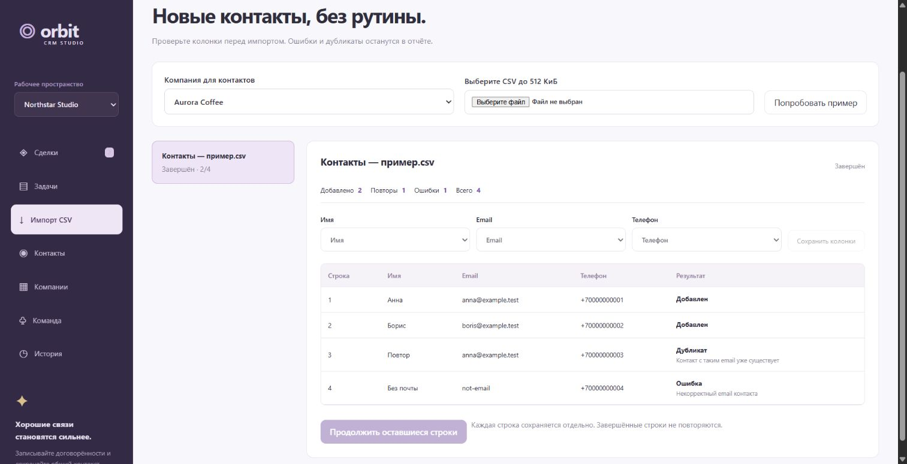

# Q08 CRM: actual Imports browser journey

26 сентября 2026, INTEGRATION HEAD392170d, current built public frontend.
**Desktop owner Imports journey PASS; mobile360 и running cancel не приняты.**
Root raw53023 выполнялся параллельно; его состояние не выводится из этого browser report.
Предыдущий raw95073 PASS относится к другому checkpoint, не является current gate этого отчёта.

## Изолированный стенд

Existing `node scripts/browser-session.mjs crm`, own PTY52707, loopback http://127.0.0.1:56863,
own data C:/Users/wenay/AppData/Local/Temp/wenay-browser-zOW75E. Synthetic default owner/owner-pass.
Own Chrome session «🧪 CRM import», primary tab1864035236; user tabs/config/data не использовались.
Server/app/scaffold/helper/package/планы не менялись; builds/npm/heavy checks/Docker этим этапом не запускались.
CSV — существующий built-in synthetic пример приложения, не пользовательский file/contacts.
Все mutations через видимый UI и настоящий native Imports resource, без API bypass/ledger fixture.

## Actual результаты

1. Owner login → Northstar Studio → Imports → «Попробовать пример».
   Preview показывает4 строки,0/4, default mapping Имя/Email/Телефон, все rows ожидают.
   До explicit apply контакты не добавлялись. «Сохранить колонки» отработало без error banner.
2. Явное «Начать импорт» disabled controls на время pending. Завершение:
   **Добавлено2 / Повторы1 / Ошибки1 / Всего4**.
   Анна anna@example.test и Борис boris@example.test добавлены; repeated anna email — «Дубликат»
   / «Контакт с таким email уже существует»; not-email — «Ошибка» / «Некорректный email контакта».
3. Через visible Contacts: исходный Илья·Aurora плюс Анна/Борис, company Aurora Coffee,
   ожидаемые email и synthetic phone; нет контакта «Повтор» или «Без почты».
4. Повторное «Попробовать пример» того же CSV возвращает прежний completed2/4 job.
   Job list остаётся с одним элементом; автоматического нового apply/дополнительных контактов не наблюдалось.
5. Desktop captured dev.logs(error) `[]` до/после journey. Logout подтверждён login heading,
   затем все own tabs закрыты. Один semantic logout click не изменил state; свежий AX target33
   успешно выполнил logout. До ретаргетинга DOM rect кнопки находился ниже viewport; product defect
   не подтверждён этим automation action и не исправлялся.

Реальный screenshot completed job, counts и duplicate row:

## Limits и cleanup

Requested viewport360×640 **не дал actual mobile**: две новые own tabs measured innerWidth1528,
innerHeight726, document scrollWidth1513. Override reset выполнен, дополнительные own tabs закрыты.
Screenshot — desktop viewport; не утверждается mobile360/physical touch/installed acceptance.

4-row import завершился до наблюдения active running cancel. В source предусмотрен ai.cancelRun
для running run; это наличие кода, не actual cancellation PASS. Cancel/restart/uncertain network retry,
role revocation/org switching и произвольный CSV file upload не проверялись этим bounded journey.
Использование встроенного synthetic примера не подтверждает browser file chooser path.

Own helper получил stop, **exit0**; Test-Path exact own temp **False**,
own port56863 listen count **0**. Root процессы/данные/прежние profiles не трогались.
Computer Use skill применён для UI workflow; browser только local fixture, внешних передач не было.

Exact scope: этот report и doc/reports/crm-import-browser-20260926.png; own progress временный.
