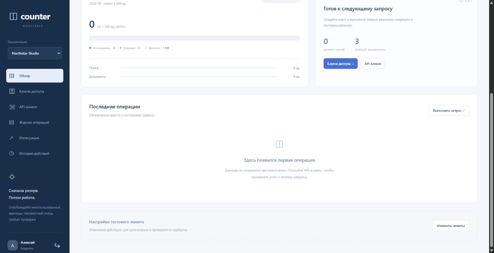
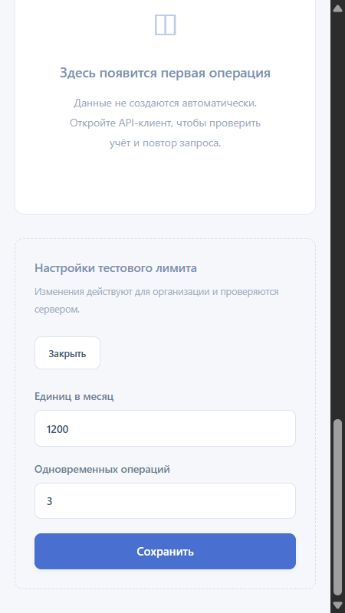

# Q08 Metering: owner quota и auditor browser journey

26 сентября 2026, INTEGRATION existing current build. **Bounded quota UI journey PASS**:
owner save/discard/reopen, auditor readonly, measured owner360×640, console и own cleanup.
Это отдельная human UI приёмка; current merged/native/root gates не выводятся из этого report.
HEAD при завершении94f0190; builds/npm/heavy checks/Docker этим этапом не запускались.

## Изолированный flow

Existing `node scripts/browser-session.mjs metering`, own PTY70500,
http://127.0.0.1:56145, own temp C:/Users/wenay/AppData/Local/Temp/wenay-browser-XSXLBS.
Own Chrome owner tab1864035244, auditor tab1864035245, session «🧪 Metering lab».
Default synthetic accounts/passwords; user data/config/credentials не читались.
No app/helper/package/plan changes, external messages/providers/payments/keys не создавались.
Все изменения лимита выполнены existing UI/native command, не прямой state/journal записью.

1. Owner overview: used0, reserved0, available1000, concurrency2, active keys0 и empty operations.
2. «Изменить лимиты» → monthly units1200/concurrent3 → explicit Save.
   Reactive overview без reload показывает available1200/limit1200 и3 одновременные операции;
   used/reserved остаются0, fictional usage не добавлена.
3. Reopen → draft9999 → Close без Save. Overview остаётся1200, повторное открытие показывает1200/3.
   Draft не стал authoritative limit и не сохранился в следующий form instance.
4. Independent synthetic auditor login: same authoritative1200 available/3 concurrency,
   «Изменить лимиты» count0, owner form/controls отсутствуют. Mutation bypass не выполнялся.
5. Original owner responsive form: measured innerWidth360/innerHeight640/document scrollWidth345.
   Inputs1200/3 и Save button помещаются; Save при360 закрывает form без error и сохраняет значения.
   Первые immediate измерения новой auditor tab дали1528×726; это другая tab, не mobile evidence.
   Temporary viewport reset вызван перед закрытием; обе own tabs logout → login heading → closed.
6. Captured console errors `[]` owner и auditor. Auditor first semantic logout click не сменил state;
   свежий bound AX target17 успешно logout. UI/source дефект не подтверждён и не исправлялся.

## Screenshots и границы

Desktop quota/overview после сохранения:

Measured owner360 quota form; PNG capture окружение само по себе не является физическим mobile device:

Quota-only flow достаточен для этого bounded slice. Reserve/commit/release/uncertain reconciliation,
key issuance/revoke, real product machine use, notifications/webhooks, current-role revoke, restart,
physical touch/Android/iOS/installed clients и платные биллинговые операции здесь не проверялись.
Auditor absence UIcontrols не заменяет отдельные server negative RPC proofs.

Own helper stop **exit0**; exact own temp Test-Path **False**, port56145 listen count **0**.
Root процессы/профили/архивы не трогались. Computer Use workflow использован только local fixture.
Scope: report + два screenshots; own progress временный. Source/architecture change не требуется.
